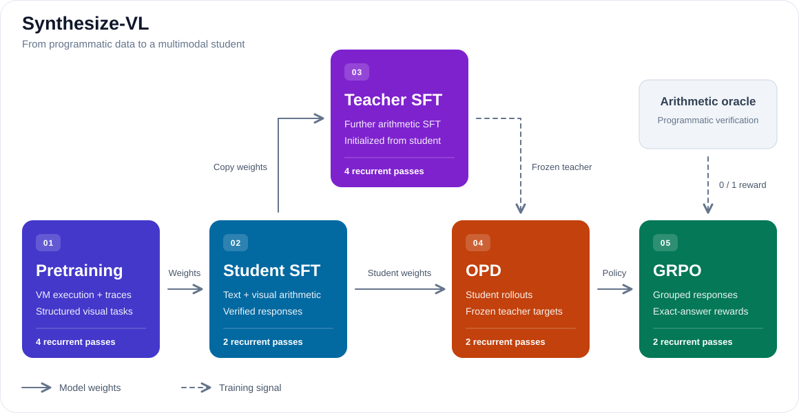

# Synthesize-VL: Native Multimodal Language Modeling with Synthetic Data

Synthesize-VL is a native multimodal language model built with **fully synthetic data**, supported by an end-to-end pipeline for pretraining, supervised fine-tuning (SFT), on-policy distillation (OPD), and group relative policy optimization (GRPO).

The model combines byte-level text and image patches in a shared recurrent Transformer with manifold-constrained hyper-connections (mHC), gated attention, and hybrid local/global attention. Programmatic generators produce VM programs, visual scenes, arithmetic questions, and verified answers and worked solutions. Data generation uses no external LLM.

The repository contains seeded data generators, YAML architecture and training configurations, training and evaluation runners, a CLI inference demo, and [benchmark results](#evaluation-results) for text and visual arithmetic.

## Text-only arithmetic

Evaluate a fully parenthesized integer expression containing addition, subtraction, multiplication, and exact division. Training responses either show the calculation steps or give only the final answer.

**Example prompt**

```text
Question: Compute (((-28 + (14 + 0)) * -11) + 16).
Show your steps.
```

**Oracle response**

```text
Work:
14 + 0 = 14
-28 + 14 = -14
-14 * -11 = 154
154 + 16 = 170
Answer: 170
```

This example comes from `generate_sft_example()` with `configs/sft_data.yaml`, validation index `100`, medium difficulty, and worked output enabled. Direct-answer examples instead request `Give only the answer.` and return `Answer: 170` followed by a newline.

## Visual arithmetic

Count the objects matching each color/shape rule in a generated 64×64 image, multiply their counts by the specified weights, and sum the contributions. Weights can be positive, negative, or zero. Distractors may be present and are worth zero points.


**Example prompt**

```text
Question: In the image, each red square is worth -16 points; each yellow triangle is worth 8 points; all other objects are worth 0 points. What is the total score?
Show your steps.
```

**Oracle response**

```text
Work:
red squares: 3
yellow triangles: 1
3 * -16 = -48
1 * 8 = 8
-48 + 8 = -40
Answer: -40
```

The red circle contributes zero. This image and response come from `generate_sft_example()` with `configs/sft_data.yaml`, validation index `103`, medium difficulty, and worked output enabled.

## Pretraining data

Pretraining combines small executable programs with structured visual tasks. All labels come from the VM interpreter or the generated scene's object records. Sampling uses a fixed mixture of 50% VM and 50% visual examples, defined in `pretraining/tasks.py`; foundation, intermediate, and advanced profiles vary the difficulty.

**VM example: predict the final state and emitted bytes**

```text
VM r=5,4
P:
SUB0,-4
XOR1,2
SUB1,1
COPY1,0
EMIT0
H:
```

The completion starts immediately after `H:`:

```text
9,9
O:09
```

Registers start at `(5, 4)` and arithmetic wraps modulo 65,536. `H:` requests the final register state; `O:09` represents the emitted byte in hexadecimal. Other programs include bounded repeats and conditional branches. This example uses seed `2026`, validation index `1`, and the foundation profile.

Within VM training, `vm_execute_probability` controls the supervision mixture. For example, `0.75` selects execution supervision for 75% of VM examples: the program is the prefix and only its verified result is supervised. The remaining 25% predicts the full serialized document, including program and result. Text trace documents also use `T:` for intermediate register states, `H:` for the final state, and `O:` for hexadecimal output. Binary documents instead place raw output bytes after `O:\n`.

**Visual examples**

The same scene can support four pretraining tasks:


| Task | Prefix | Oracle completion |
| --- | --- | --- |
| Inventory | `inventory:` | `r0c1 yellow circle`<br>`r2c0 green circle` |
| Color counts | `color_counts:` | `red=0 blue=0 green=1 yellow=1` |
| Spatial extremes | `extremes:` | `left=green circle r2c0; right=yellow circle r0c1` |
| Weighted sum | `score: green circle=2, yellow circle=3; value=` | `5` |

These examples use seed `2026`, validation index `100`, and the foundation profile. Rows and columns are zero-based. Visual pretraining supervises the completion and EOS; the image and task prefix are inputs. It shares the scene renderer with visual arithmetic SFT, which adds natural-language instructions and worked calculations.

## Model components

The model combines the following components:

- **Multimodal embedding:** UTF-8 byte tokens use a 260-entry embedding. An 8×8-stride convolution turns each 64×64 image into 64 patch vectors. Learned row/column and modality embeddings are added, then image patches are prepended to text embeddings.
- **Transformer block:** pre-normalized attention and SwiGLU feed-forward sublayers, each with a residual connection. RMSNorm is used before both sublayers.
- **Gated attention:** an optional sigmoid gate is computed for every token and attention head from the query hidden state. It scales that head’s attention output; zero-initialized gate parameters start at 0.5.
- **Recurrent core:** a stack of `core_layers` distinct Transformer layers is applied repeatedly. Each layer has its own parameters, and the same stack is reused for `recurrent_steps` iterations. A zero-initialized learned bridge adds an update from the current state and fixed Prelude representation once per iteration. A Prelude and Coda block surround the core.
- **mHC:** an alternative recurrent-core residual path that carries multiple streams. Learned pre/post gates and a Sinkhorn-normalized matrix route information between streams; the streams are averaged before the Coda.
- **Hybrid local/global attention:** an optional recurrent-core mask. Text attends to image patches, a local causal text window, and selected initial text positions as global keys. The Prelude and Coda retain full prefix-causal attention.
- **Position modes:** RoPE applies rotary positions to attention queries and keys; image patches use position zero. NoPE omits RoPE. Multimodal models can instead add learned text positions.

The multimodal recurrent path is: **joint embeddings → Prelude → shared recurrent core (standard or mHC) → Coda → text-token logits**.

## Training flow

The student first learns synthetic text and visual arithmetic from the pretraining checkpoint. Teacher SFT then loads the trained student's parameters, increases the recurrent passes from two to four, and continues supervised training with a fresh optimizer. OPD starts from the SFT student and uses the frozen SFT teacher's predictions on student-generated continuations. GRPO then updates the distilled student using programmatically checked final-answer rewards.



Run the following commands from the repository root. Python 3.11+ and `uv` are required; `uv run` uses the dependencies in `pyproject.toml`. Select the device count through `runtime.devices`, e.g., two JAX devices.

Example training settings:

| Stage | Example prompts/examples per batch | Example training budget | Output |
| --- | --- | --- | --- |
| Shared pretraining | 8 | 10,000 optimizer updates | `checkpoints/pretrain` |
| Student SFT | 8 | 10,000 optimizer updates | `checkpoints/student` |
| Teacher SFT from student | 8 | 3,000 additional optimizer updates | `checkpoints/teacher` |
| OPD | 8 | 500 optimizer updates | `checkpoints/opd` |
| GRPO | 4, with 8 responses each | Up to 100 GRPO steps / 200 optimizer updates | `checkpoints/grpo` |

## Pretraining

Run the YAML-configured pretraining with:

```bash
uv run scripts/run_pretrain.py --config configs/pretrain.yaml
```

Task sampling stays fixed during a run: a 50/50 VM/visual mixture distributed uniformly over each modality's task/profile combinations. Sampling probabilities are defined in `pretraining/tasks.py`; `data.visual_loss_share` weights the visual contribution to the training loss. The training budget is configurable, e.g., 10,000 optimizer updates. The runner writes checkpoints, `train_metrics.csv`, and `validation_history.csv` under `runtime.checkpoint_root`, such as `checkpoints/pretrain`.

Model settings live in `configs/teacher_architecture.yaml` and `configs/student_architecture.yaml`. Pretraining and SFT YAML files select one through `architecture_config`, resolved relative to the training config's directory. OPD selects both through `teacher_architecture_config` and `student_architecture_config`; GRPO selects the student through `architecture_config`. OPD and GRPO architecture paths are relative to the working directory. The loaders create a `ModelArchitecture` from each file, and `build_model()` constructs the Flax model from those values.

Pretraining uses the teacher architecture. Both presets use hidden size 896, 14 attention heads, four distinct core layers, and two mHC streams. They share parameter shapes and differ in recurrent iterations: four for the teacher, two for the student. Each recurrent iteration applies all `core_layers` in order; including Prelude and Coda, the model performs `2 + core_layers × recurrent_steps` Transformer block applications: 18 for the teacher and 10 for the student. Fewer recurrent passes reduce computation while retaining the same parameter count.

## SFT for student

Student SFT loads the shared pretraining checkpoint and uses fewer recurrent iterations:

```bash
uv run scripts/run_train_sft.py --config configs/sft_student.yaml
```

The SFT dataset contains text arithmetic and visual arithmetic, with worked solutions or direct answers. Preview examples using `uv run scripts/run_preview.py`, configured by `configs/sft_data.yaml`.

The preview writes easy, medium, and hard visual examples to `runs/sft_preview/`. Its `pretrained_checkpoint_root` setting is not read by the preview runner; previewing generates data without loading a model.

## SFT for teacher

After student SFT finishes, train the mixed text/visual teacher from the student checkpoint with the same runner:

```bash
uv run scripts/run_train_sft.py --config configs/sft_teacher.yaml
```

Student SFT loads `checkpoints/pretrain` and writes `checkpoints/student`. Teacher SFT loads `checkpoints/student` and writes `checkpoints/teacher`. The teacher reuses all student parameter arrays with more recurrent passes; it starts a fresh optimizer and data stream. Its update count measures additional teacher training, starting at zero.

Both SFT configs use `data.seed` for training examples and `evaluation.seed` for held-out loss and generation evaluation. Generation requests worked solutions and scores the final answer. Keeping the same evaluation seed compares both models on the same problems.

SFT supervises response bytes and EOS, masking prompt bytes and padding. Example sampling mixtures are 50% text and 50% visual tasks for the student, then 30% text and 70% visual tasks for the teacher, with 90% worked responses in both stages. These probabilities and the difficulty mixture are configured separately for each stage through `data.text_probability`, `data.cot_probability`, and `data.difficulty_weights`. The objective combines the average losses for each modality with equal shares for text and vision when both occur in a batch.

## On-policy distillation (OPD)

After SFT, run:

```bash
uv run scripts/run_train_opd.py --config configs/opd.yaml
```

The current preset loads the student from `checkpoints/student` and the teacher from `checkpoints/teacher`, creates a fresh student optimizer, and writes student checkpoints to `checkpoints/opd`. Checkpoint roots select their latest step; exact step directories can also be specified.

OPD reuses the synthetic arithmetic prompt generator. The current student samples continuations, and the frozen teacher predicts the next-token distribution at those same prefixes. The update minimizes reverse KL, `KL(student || teacher)`, over valid rollout positions, including EOS and excluding positions after EOS. Oracle responses are not included in the rollout inputs.

Rollout settings are configurable, e.g., temperature 1.0, a 512-position text buffer, and at most 256 new tokens. Sampling uses full-prefix model forwards and skips further forwards once every response in the batch has emitted EOS.

`data.seed` controls prompts, `rollout.seed` together with the update index controls sampling, and `evaluation.seed` controls held-out evaluation problems.

## Group relative policy optimization (GRPO)

After OPD, run:

```bash
uv run scripts/run_train_grpo.py --config configs/grpo.yaml
```

The preset loads `checkpoints/opd`, creates a fresh optimizer, and writes to `checkpoints/grpo`. It reuses the SFT task generator and samples responses stochastically. GRPO always requests worked solutions; `data.cot_probability` controls the worked/direct mixture in SFT and OPD. The difficulty mixture can be tuned, e.g., 20% easy, 50% medium, and 30% hard. The teacher is not used during this stage.

For each prompt, the model samples a group of responses. A completed, EOS-terminated response receives reward 1 if its final `Answer:` line matches the arithmetic oracle; every other response receives 0. Intermediate reasoning is not checked. Rewards are centered and normalized within each prompt group, and equal-reward groups receive zero advantages.

The update uses a clipped probability-ratio objective with a configurable `clip_epsilon`, e.g., `0.2`. The same responses, rewards, advantages, and behavior-policy log probabilities are reused across PPO epochs. Token losses are summed over valid positions and divided by the fixed rollout budget. The current implementation has no reference-model KL penalty or KL diagnostic.

| Setting | Example value | Meaning |
| --- | --- | --- |
| `data.batch_size` | 4 | Distinct prompts in one rollout batch |
| `grpo.group_size` | 8 | Sampled responses per prompt; 32 responses with 4 prompts |
| `rollout.new_tokens` | 256 | Maximum continuation tokens, including EOS |
| `rollout.ppo_epochs` | 2 | Optimizer updates on the same response batch |
| `runtime.max_updates` | 100 | Completed GRPO steps, each including all PPO epochs |
| `optimizer.total_steps` | 200 | Individual optimizer updates |
| `optimizer.warmup_steps` | 20 | Individual warmup updates; 10 GRPO steps with 2 PPO epochs |

Runtime logging, validation, saving intervals, and checkpoint directory numbers count GRPO steps. The saved optimizer counter counts individual optimizer updates; for example, GRPO step 50 saves `step_00000050` containing optimizer update 100 with two PPO epochs.

A batch with no reward variation in any group is skipped without an optimizer update. `runtime.max_uninformative_streak` sets how many consecutive such batches stop the run, e.g., 10, after which final evaluation runs. `data.seed` controls prompts; `rollout.seed` and the data-batch index control sampling, including skipped batches; `evaluation.seed` controls held-out evaluation.

## CLI inference

Load a checkpoint for interactive inference with `configs/demo.yaml`:

```bash
uv run scripts/run_demo.py --config configs/demo.yaml
```

The menu generates text or visual arithmetic examples, accepts custom arithmetic expressions, switches difficulty, and toggles worked responses. Generated examples include an oracle answer; custom expressions are passed to the model without an oracle. Images are saved under `save_dir`, e.g., `runs/demo`; `open_image` controls whether the system image viewer opens them.

Use `--once` to generate one visual example and exit:

```bash
uv run scripts/run_demo.py --config configs/demo.yaml --once
```

`checkpoint_root` selects the weights, and `architecture_config` selects the model, including its recurrent pass count. The demo uses greedy decoding through `generate_greedy()`, which runs full-prefix forwards with a fixed padded text buffer.

## SFT difficulty

Both models use the same arithmetic generators and difficulty levels. Training samples easy, medium, and hard according to `data.difficulty_weights`; OOD is reserved for evaluation. The following tables illustrate the dataset difficulty settings, which may also be adjusted as experiments evolve.

Text arithmetic uses fully parenthesized expressions with signed integer operands and `+`, `-`, `*`, and exact integer division. The intermediate bound applies to every operation result.

| Level | Operations | Operand range | Maximum absolute intermediate value |
| --- | --- | --- | --- |
| Easy | 1–2 | −10…10 | 100 |
| Medium | 3–4 | −30…30 | 1,000 |
| Hard | 5–6 | −50…50 | 10,000 |
| OOD | 7–8 | −100…100 | 100,000 |

Visual arithmetic counts the objects matching each scored color/shape category, multiplies each count by its weight, and sums the contributions. Weight ranges below are absolute magnitudes; weights can be negative. Distractors may be absent or present.

| Level | Objects | Scored categories | Absolute weight |
| --- | --- | --- | --- |
| Easy | 2–3 | 1 | 0–10 |
| Medium | 4–6 | 2 | 0–30 |
| Hard | 6–8 | 2–3 | 0–50 |
| OOD | 8–9 | 3 | 51–100 |

OOD text examples have more operations than training examples. OOD visual weights have magnitudes outside all training weight ranges.

## Evaluation and saved state

Pretraining reports teacher-forced loss by VM/visual task and profile. With `runtime.evaluate_ood_at_end` enabled, it also evaluates held-out program lengths, operand magnitudes, object counts, and visual weights at the end. Periodic VM validation uses execution supervision; final VM evaluation includes both full-document and execution supervision.

SFT, OPD, and GRPO report teacher-forced validation loss initially, periodically, and at the end. They also run greedy generation evaluation at the start of a fresh run and at the end. Evaluation requests worked solutions and scores the final integer answer, requiring EOS. `evaluation.examples_per_group` sets the validation count, and `evaluation.exact_examples_per_level` sets the generation count for each task/difficulty combination. Validation and generation use separate validation/test splits. The [reported results](#evaluation-results) use 50 examples per task/difficulty combination.

`Nats/target` is average negative log probability over supervised targets, including EOS. `BPB` averages byte-target loss only and converts it to bits. These teacher-forced metrics measure prediction with the correct preceding response tokens; generated-answer accuracy measures complete solutions produced by the model.

| Entry point | Saved artifacts |
| --- | --- |
| Pretraining | Step checkpoints, `resolved_pretrain.yaml`, `train_metrics.csv`, and `validation_history.csv` |
| SFT / OPD / GRPO | Step checkpoints; training and evaluation metrics are printed to the console |
| Data preview | Generated images under `runs/sft_preview/` |

Checkpoints contain model parameters, optimizer state, the deterministic data cursor, and a configuration digest. Starting a new stage loads parameters with a fresh optimizer; `runtime.resume_from` restores the full state of the same stage from an exact step directory. Source checkpoint settings accept either an exact step directory or a root that selects the latest numeric step. Use exact source directories to repeat a stage from the same weights.

Data generators use explicit seeds, split identifiers, and sample indices. Model initialization also uses an explicit seed, e.g., 0 in the training runners. Keep code, configuration, source checkpoints, dependencies, hardware, and device layout fixed when comparing repeated runs; GPU bitwise reproducibility also depends on execution kernels.

Run the tests with:

```bash
uv run pytest
```

## Script organization

Current training and data preview entry points live directly under `scripts/`. Small model and component checks live in `scripts/smoke/`; earlier training runners live in `scripts/legacy/`.

See [the scripts guide](scripts/README.md) for commands, dataset differences, and the meaning of each group.

Reusable model and training code stays organized by responsibility under `synthesize_vl/`. Earlier datasets and streaming pipelines live in `synthesize_vl/legacy/`; common document and cursor types live in `synthesize_vl/data/schema.py`. See [the library guide](synthesize_vl/README.md) for details.

## Evaluation results

Evaluation uses **50 examples per task/difficulty combination: 400 matched test problems per model**, with seed `2026`, worked-solution prompts, greedy decoding, a 1,024-position text buffer, and at most 512 new tokens. Correctness requires an EOS-terminated response with the correct final integer answer; intermediate calculations are not scored. All four models completed all 400 responses with EOS and parseable final answers.

See the [student SFT](configs/sft_student.yaml), [teacher SFT](configs/sft_teacher.yaml), [OPD](configs/opd.yaml), and [GRPO](configs/grpo.yaml) YAML configurations for training settings.

### Accuracy

| Task / difficulty | Student SFT | Teacher SFT | OPD | GRPO |
| --- | ---: | ---: | ---: | ---: |
| **Overall (400)** | **36.25% (145/400)** | **44.00% (176/400)** | **36.00% (144/400)** | **36.50% (146/400)** |
| In-domain only (300) | 48.3% | 58.7% | 48.0% | 48.7% |
| **Text arithmetic (200)** | 40.0% | 44.0% | 40.5% | 39.0% |
| Text / easy (50) | 90.0% | 90.0% | 92.0% | 90.0% |
| Text / medium (50) | 44.0% | 54.0% | 46.0% | 48.0% |
| Text / hard (50) | 26.0% | 32.0% | 24.0% | 18.0% |
| Text / OOD (50) | 0.0% | 0.0% | 0.0% | 0.0% |
| **Visual arithmetic (200)** | 32.5% | 44.0% | 31.5% | 34.0% |
| Visual / easy (50) | 86.0% | 96.0% | 90.0% | 86.0% |
| Visual / medium (50) | 28.0% | 54.0% | 20.0% | 34.0% |
| Visual / hard (50) | 16.0% | 26.0% | 16.0% | 16.0% |
| Visual / OOD (50) | 0.0% | 0.0% | 0.0% | 0.0% |

**OOD remains undefeated:** every model scored 0/100 on the text and visual OOD problems. Generalizing to longer expressions, larger scenes, and unseen weight ranges remains an open challenge.

In-domain accuracy includes easy, medium, and hard problems; OOD accounts for the other 100 problems. One answer changes a 50-problem family score by two percentage points.

### SFT results

The teacher answers 31 more problems correctly than the student: 44.0% versus 36.25% overall. Its advantage is larger on visual arithmetic (44.0% versus 32.5%) than on text arithmetic (44.0% versus 40.0%).

### OPD and GRPO comparison

Each comparison uses the same individual test problems.

| Before → after | Newly correct | Newly incorrect | Net correct answers |
| --- | ---: | ---: | ---: |
| Student SFT → OPD | 18 | 19 | -1 |
| OPD → GRPO | 14 | 12 | +2 |

GRPO gains 14 newly correct answers and loses 12 relative to OPD, a net improvement of two answers (0.5 percentage points). OPD and GRPO remain close to the SFT student overall, despite the stronger teacher. These small differences between student checkpoints do not establish a clear overall post-training improvement.

## Reference

[Gated Attention for Large Language Models: Non-linearity, Sparsity, and Attention-Sink-Free](https://arxiv.org/abs/2505.06708)

[Scaling up Test-Time Compute with Latent Reasoning: A Recurrent Depth Approach](https://arxiv.org/abs/2502.05171)

[mHC: Manifold-Constrained Hyper-Connections](https://arxiv.org/abs/2512.24880)

[On-Policy Distillation of Language Models: Learning from Self-Generated Mistakes](https://arxiv.org/abs/2306.13649)

[DeepSeekMath: Pushing the Limits of Mathematical Reasoning in Open Language Models (GRPO)](https://arxiv.org/abs/2402.03300)
